# 鼠标连点器工具 — 需求交接（HANDOFF）

> 整理日期：2026-10-31。本文档只整理用户提出的需求与提供的材料，未开始任何开发。

## 一、要做的东西

参照"全方位鼠标连点器(360专版)"软件的主界面，做一个鼠标/键盘脚本小工具，核心三点：

1. **脚本文件格式要简单**：用户可以在 Word 文件里把脚本代码改好，软件直接识别运行，比现在的录制方式更快。
2. **脚本名称字体颜色可改（红 / 绿两种）**：保存的脚本用颜色区分开，用来输入账号和密码，点击就复制进去。
3. **界面沿用参考软件的主列表页**：需求文档截图上红字标注"脚本可以沿用此页面"；红圈圈起来的操作就是要用的内容。

## 二、本次输入（用户提供的文件）

| 文件 | 说明 |
| --- | --- |
| `MouseComboDevice360KingSetup(1).exe` | 参考软件"全方位鼠标连点器(360专版)"安装包，36,473,768 字节 |
| `需求(2).doc` | 需求说明文档，整份由 11 张软件界面截图组成（红圈/红字为用户标注），正文无文字。已转换出副本 `artifacts/tmp/需求2.docx`（原件只读未动） |
| `双数快捷(1).qfwjb` | 参考软件导出的脚本样例，UTF-8 带 BOM 纯文本，2,245 字节 |
| 3 张微信截图 | 参考软件主列表界面，含用户红箭头/红字标注 |

## 三、脚本样例实测格式（双数快捷(1).qfwjb）

纯文本，每两行一组：**动作行 + 延时行**，循环排列：

```
鼠标移动到：134,87
ms200
鼠标左键按下：0,0
ms30
鼠标左键抬起：0,0
ms200
键盘NumPad1键按下：75
ms15
键盘NumPad1键抬起：75
ms100
```

- 动作类型（样例中出现）：`鼠标移动到：x,y`、`鼠标左键按下：0,0`、`鼠标左键抬起：0,0`（坐标列固定 `0,0`）、`键盘<键名>键按下：<虚拟键码>`、`键盘<键名>键抬起：<虚拟键码>`
- 键名与键码对应（样例中出现）：NumPad1→75、NumPad2→76、NumPad3→77、NumPad5→79、NumPad6→80、NumPad8→82、NumPad9→83、Decimal→88
- 延时行：`ms<毫秒>`，样例中出现过 ms15 / ms30 / ms100 / ms200 / ms500
- 微信截图中该脚本位于 `C:\Users\Administrator\Desktop\双数快捷(1).qfwjb`；工作区副本为 `G:\xiangmu\鼠标连点器\双数快捷(1).qfwjb`

## 四、完整工作流（按参考软件主界面，微信截图 V2.1.0.5）

1. 点左上角 **导入** 按钮，把 `.qfwjb` 脚本文件加入列表；列表列为：**鼠标录制名称 / 文件路径 / 操作**。
2. 勾选要用的脚本前面的 **复选框**（微信截图红箭头标注处）。
3. 底部 **回放次数** 下拉选"自定义次数"，填入次数（如 `1` 次）。
4. 点右下角 **运行鼠标宏(F10)** 执行；旁边另一个按钮是 **创建鼠标宏(F9)**。
5. 每行"操作"列有 5 个图标：设置 / 删除 / 打开所在文件夹 / 复制 / 排序；右上角有 **清空** 按钮。

## 五、功能需求清单

### A. 用户微信消息明确要求

1. 界面沿用参考软件主列表页（需求文档截图红字"脚本可以沿用此页面"）。
2. 脚本格式简单：在 Word 里改好代码，软件直接识别，更快。
3. 脚本名称字体颜色可改：红色和绿色就可以；保存的脚本用颜色区分开，用来输入账号和密码。
4. 点击就把保存的内容复制进去（账号/密码输入场景）。

### B. 需求文档(2).doc 内截图标注

1. **脚本编辑界面**（doc 图1）：红圈标注左侧操作列表中的 **鼠标移动到**、**等待**、**鼠标左键点击** —— 用户要用的核心操作。
2. **鼠标点击对话框**（doc 图4）：红字"此页面增加一功能 执行次数：0~99（默认一次）"。
3. **键盘点击对话框**（doc 图8）：红字"此页面增加一功能 执行次数：0~99 默认一次"。
4. **键盘操作**（doc 图10）：红字"键盘操作：增设一次输入多位按键"—— 一次输入整串字符（如整个账号/密码）。
5. **主界面脚本列表**（doc 图11）：红字"脚本可以沿用此页面"；红字"可改变颜色字体"箭头指向列表中的脚本名称。

### C. 对话框现有选项（截图可见，作为界面参照）

- **鼠标移动对话框**：移动到坐标 X / Y + "选取坐标"按钮；延迟（默认 30）毫秒后执行下一个动作；1000 毫秒等于 1 秒。
- **等待时间对话框**：指定一个动作执行之后等待多久再执行下一个动作；延迟毫秒。
- **鼠标点击对话框**：鼠标按键下拉（鼠标左键 / 鼠标中键 / 鼠标右键）；动作下拉（单击(按下+松开) / 按下 / 松开 / 双击）；同时按下键盘复选框（左Ctrl / 右Ctrl / 左Shift / 右Shift / 左Alt / 右Alt / 左Win / 右Win）；延迟毫秒。
- **键盘点击对话框**：键盘按键输入框（提示"直接按下键盘按键"）；键盘动作下拉（单击(按下+松开) / 按下 / 松开 / 双击）；同时按下键盘复选框（同上 8 项）；延迟毫秒。
- **脚本编辑界面左侧分组**（doc 图1、图7）：
  - 鼠标操作：鼠标移动到 / 等待 / 鼠标右键点击 / 鼠标右键按下 / 鼠标右键松开 / 鼠标左键点击 / 鼠标左键按下 / 鼠标左键松开 / 鼠标左键双击 / 鼠标中键点击 / 鼠标中键按下 / 鼠标中键松开 / 鼠标滚轮滚动
  - 键盘操作：键盘点击 / 快捷按键
  - 常用任务：启动/关闭程序 / 打开网页 / 打开文件 / 关机/重启/休眠
  - 右侧：脚本名称输入框（默认形如 `鼠标宏-20261030225625268.qfwjb`）+ 编辑图标 + **保存鼠标宏** 按钮；"当前动作数: N" + **清空** 按钮；动作表格（序号 / 动作 / 参数 / 操作）；底部 **执行脚本** 按钮。

## 六、交付 / 验收要求（按用户原话归纳）

1. 界面沿用参考软件主列表页样式（导入、列表、勾选、回放次数、F9/F10 按钮）。
2. 脚本能在 Word（文本编辑）里改好，软件直接识别。
3. 脚本名称字体颜色红、绿两种即可，用颜色区分账号脚本和密码脚本。
4. 点击就把内容复制/输入进去。
5. 鼠标点击 / 键盘点击对话框有"执行次数 0~99，默认一次"。
6. 键盘操作支持一次输入多位按键。

## 七、截图证据

### 微信截图（用户本次消息附带）

图 1：参考软件主列表界面，两行 qfwjb 脚本（双数快捷(1).qfwjb / 双数快捷.qfwjb），路径为 C:\Users\Administrator\Desktop 下。

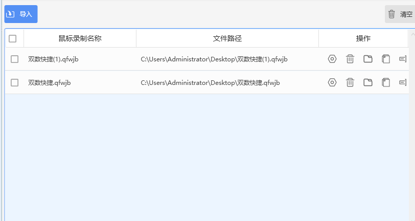

图 2：同一界面（右下角 V2.1.0.5，右上角有"登录 / 开通会员"），红箭头标注三处：勾选"双数快捷(1).qfwjb"前面的复选框、回放次数"1"次输入框、"运行鼠标宏(F10)"按钮。

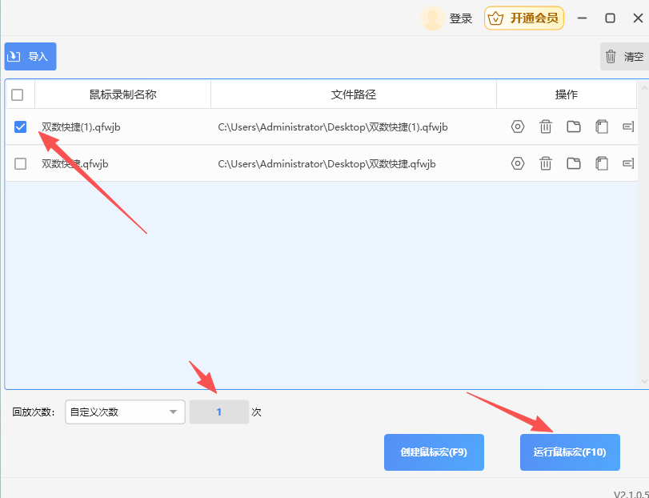

图 3：主列表界面，红字标注"可以改字体颜色"，箭头指向脚本名称"双数快捷(1).qfwjb"。

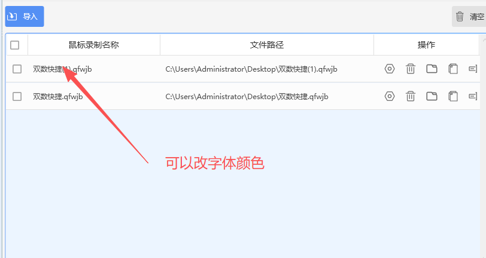

### 需求(2).doc 内嵌截图（按文档顺序，红圈/红字为用户标注）

图 4：脚本编辑窗口。左侧"鼠标操作"列表，红圈圈住：鼠标移动到、等待、鼠标左键点击；右侧脚本名输入框（鼠标宏-20261030225625268.qfwjb）、保存鼠标宏按钮、动作表格（序号/动作/参数/操作）、执行脚本按钮。

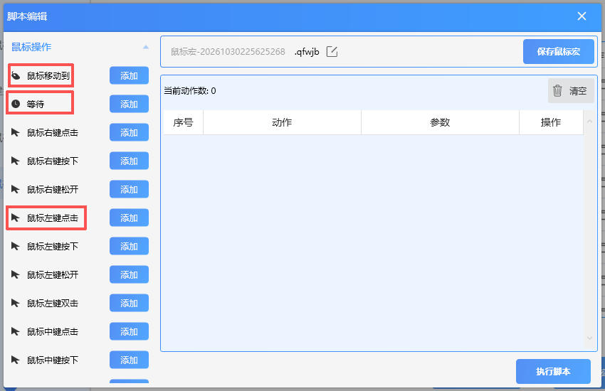

图 5：鼠标移动对话框：移动到坐标 X、Y、"选取坐标"按钮，延迟 30 毫秒后执行下一个动作。

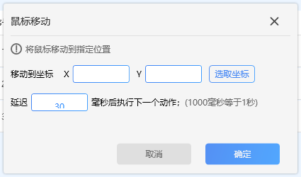

图 6：等待时间对话框：指定一个动作执行之后等待多久再执行下一个动作，延迟 30 毫秒。

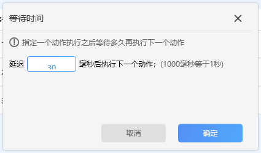

图 7：鼠标点击对话框，红字标注"此页面增加一功能 执行次数：0~99（默认一次）"。

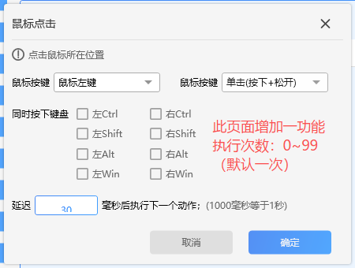

图 8：鼠标点击对话框，展开"鼠标按键"下拉：鼠标左键 / 鼠标中键 / 鼠标右键。

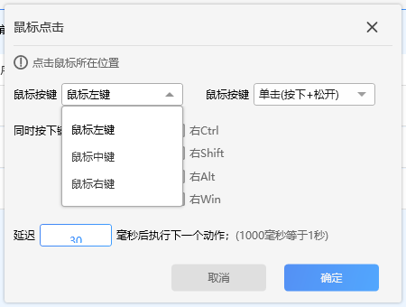

图 9：鼠标点击对话框，展开右侧动作下拉：单击(按下+松开) / 按下 / 松开 / 双击。

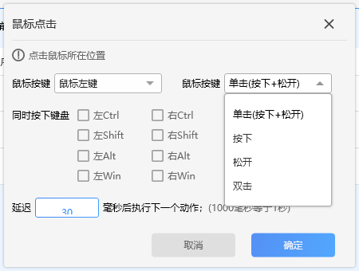

图 10：脚本编辑窗口下半部分，红框圈住"键盘操作"分组及其中"键盘点击"项；另有常用任务分组（启动/关闭程序、打开网页、打开文件、关机/重启/休眠）。

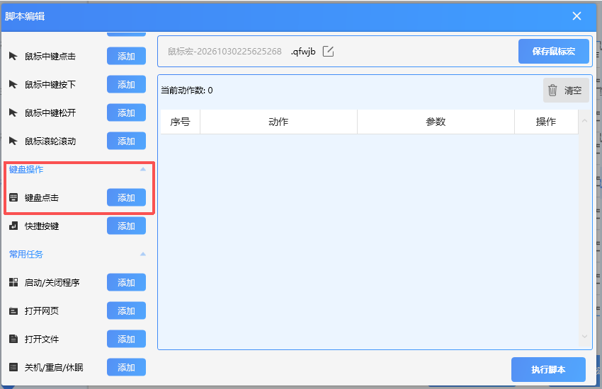

图 11：键盘点击对话框，红字标注"此页面增加一功能 执行次数：0~99 默认一次"。

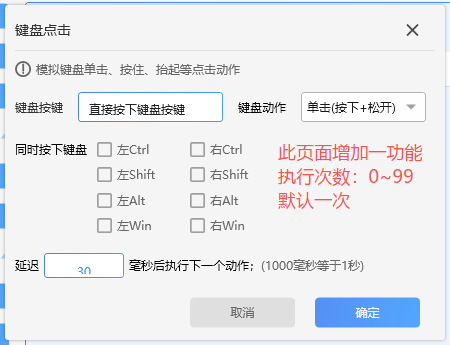

图 12：键盘点击对话框，展开"键盘动作"下拉：单击(按下+松开) / 按下 / 松开 / 双击。

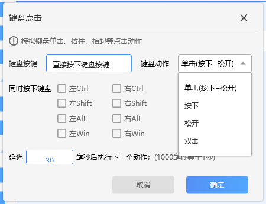

图 13：脚本编辑窗口，红箭头指向"键盘点击"添加项，红字标注"键盘操作：增设一次输入多位按键"。

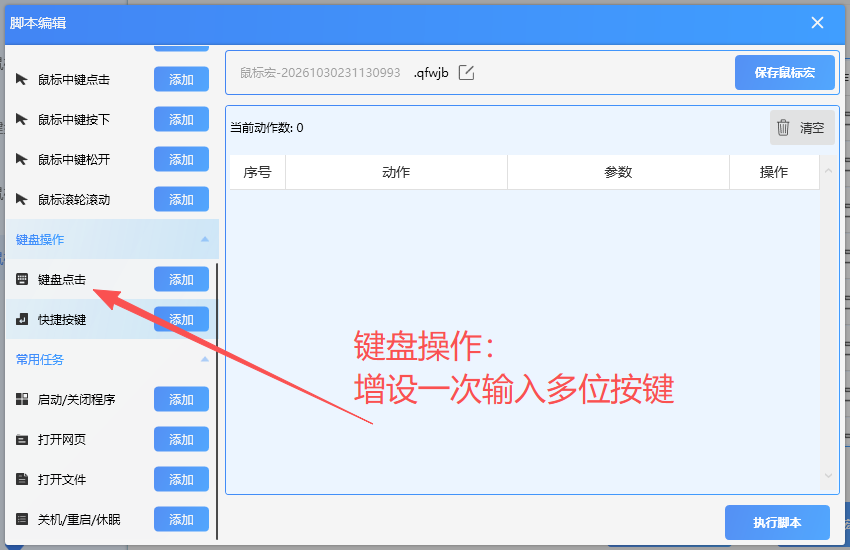

图 14：主界面"鼠标脚本"页（标题栏"全方位鼠标连点器(360专版)"，右上角"手机用户"，右下角 V2.1.0.7）。脚本名称列内容已被用户打码（可见"2信用-…""4普通-…"等命名前缀），路径为 D:\Users\Desktop\全方位鼠标连点器(360专版)\鼠标宏\…。红字两处："脚本可以沿用此页面"（指向整个列表页）、"可改变颜色字体"（箭头指向脚本名称）。

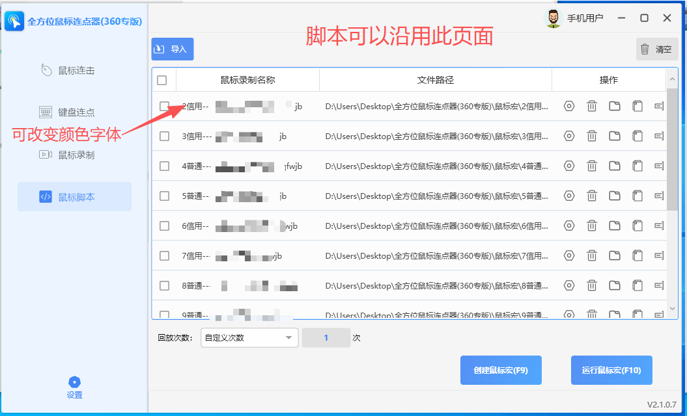

## 八、需求澄清结果（2026-10-31 用户答复）

1. 脚本文件格式：用户答复"格式不重要，看你"——由实现方决定。
2. "点击就复制进去"的行为：用户答复"看你"——由实现方决定。
3. 颜色标注对象：用户未单独答复，按截图标注执行（列表中脚本名称字体改红/绿）。
4. 参考软件版本差异：用户未单独答复，按微信截图主界面（V2.1.0.5）沿用。
5. "常用任务"分组：**不做**。
6. 账号/密码输入目标：**用户自己选择输入框**（运行前由用户把光标点到目标输入框）。
